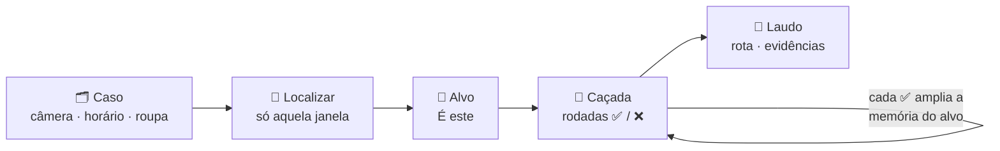
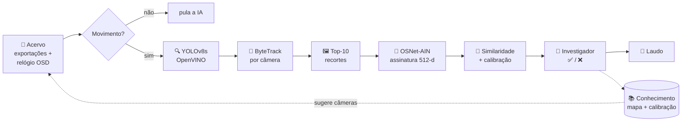

<div align="center">

# 🛡️ Sentinel-Trace

### Busca forense de pessoas entre câmeras, sob demanda, para Loss Prevention

*O Sentinel não vigia o galpão. Ele responde à pergunta do investigador: **por onde essa pessoa passou?***

<br>

[](https://www.python.org/)
[](https://pytorch.org/)
[](https://docs.ultralytics.com/)
[](https://docs.openvino.ai/)
[](https://opencv.org/)
<br>
[](https://github.com/KaiyangZhou/deep-person-reid)
[](https://github.com/ifzhang/ByteTrack)
[](https://scikit-learn.org/)
[](https://streamlit.io/)
[](https://www.sqlite.org/)


[Visão geral](#-visão-geral) •
[Como funciona](#-como-funciona) •
[Arquitetura](#️-arquitetura) •
[Stack](#-stack-tecnológica) •
[Desempenho](#-desempenho) •
[Instalação](#-instalação) •
[Uso](#-uso) •
[Roadmap](#️-roadmap) •
[Privacidade](#-privacidade-e-lgpd)

</div>

---

## 📌 Visão geral

Em centros de distribuição com **centenas de câmeras**, reconstruir o trajeto de um associado exige horas de playback manual — e rastreadores comuns "perdem" a pessoa quando ela troca de câmera, passa atrás de estantes ou empurra carrinhos que escondem o corpo.

O **Sentinel-Trace** inverte a lógica: em vez de monitorar tudo o tempo todo, ele é um **motor de busca forense sob demanda**. O investigador diz *onde e quando* a pessoa estava (ex.: a catraca onde bateu o crachá), escolhe o alvo, e o Sentinel o segue câmera a câmera, mostrando os candidatos mais parecidos para confirmação humana — até entregar um **laudo com rota cronológica e evidências**.

<table>
<tr>
<td width="50%" valign="top">

### ✨ Destaques
- 🎯 **Alvo primeiro** — só processa a câmera e a janela de tempo pedidas
- 🧠 **ReID de pedestres** (OSNet-AIN) — identidade pela aparência corporal
- 🙋 **Humano no controle** — a IA ordena, o investigador confirma
- 📈 **Aprende com o uso** — calibra a % e monta o mapa do galpão sozinho
- 🕒 **Acervo automático** — lê o relógio gravado no vídeo e sincroniza as câmeras
- 📄 **Laudo pronto** — rota, evidências e `.docx`

</td>
<td width="50%" valign="top">

### ⚡ Eficiência
- 🚀 Detector em **OpenVINO**: **2,2× mais rápido** em CPU Intel
- 🖼️ ReID **só nos 10 melhores recortes** de cada pessoa
- 🎬 **Filtro de movimento** anti-tremor: corredor parado não aciona a IA
- 💾 **Cache**: trecho já analisado nunca é reprocessado
- 🔒 **100% local**, sem GPU e sem nuvem

</td>
</tr>
</table>

---

## 🔎 Como funciona



| Etapa | O que acontece |
|---|---|
| **1. Nova investigação** | Câmera de início, data/hora, janela (± s) e, se souber, cor da camisa/calça e boné. |
| **2. Localizar** | Varre **só** aquela câmera naquela janela e lista as pessoas — quem bate com a descrição primeiro. |
| **3. Alvo** | O investigador clica em **"É este"**: o rastro vira a âncora da busca. |
| **4. Caçada** | Cada rodada varre só as câmeras sugeridas logo após o último avistamento; você confirma ✅ ou rejeita ❌. |
| **5. Laudo** | Rota em horário real, % de semelhança, margem, quem decidiu, rejeitados e prancha de evidências. |

---

## 🏗️ Arquitetura



| Camada | Economia aplicada |
|---|---|
| 📼 **Acervo** | Lê só a janela de tempo pedida, a 4 fps; trecho já varrido fica em cache |
| 🎬 **Movimento** | Comparar miniaturas custa ~2 ms; a IA (~270 ms) só roda quando algo se mexe |
| 🔍 **Detector** | YOLOv8s exportado para OpenVINO, entrada 1280×736 |
| 🖼️ **Top-10** | ReID só nos 10 melhores recortes de cada pessoa |
| 📚 **Conhecimento** | Passagens aprendidas reduzem as câmeras de cada rodada |

<details>
<summary><b>🧩 Algoritmos-chave</b> (clique para expandir)</summary>

<br>

| Componente | Como funciona |
|---|---|
| **Qualidade do recorte** | `confiança × tamanho × (não cortado na borda) × (proporção de corpo inteiro)` — favorece recortes nítidos e sem carrinho na frente. |
| **Top-K** | Escolhe os 10 melhores recortes com ≥ 0,4 s entre si (poses variadas). Só eles recebem ReID. |
| **Similaridade** | Média dos 25% maiores cossenos entre a galeria do alvo e os recortes do candidato. |
| **Calibração** | Regressão logística aprendida com pares conhecidos: pessoas co-visíveis (com certeza diferentes), metades do mesmo rastro e decisões humanas. |
| **Restrição física** | O alvo não pode estar em dois rastros simultâneos da mesma câmera. |
| **Margem** | Vantagem do candidato sobre o concorrente simultâneo na mesma câmera (≈ 0 = ambíguo). |
| **Galeria do alvo** | Cada ✅ adiciona os recortes confirmados — o alvo passa a ser reconhecido em ângulos novos. |
| **Filtro de movimento** | Miniatura 640 px, anti-tremor (dilatação/erosão 5×5), ignora o relógio, histerese de 2 s. |
| **Relógio OSD** | Lê a data/hora gravada na imagem por moldes de dígitos e acha o frame exato da virada de segundo (~1 frame de precisão). |
| **Mapa aprendido** | Cada passagem confirmada A → B grava o tempo de trânsito; as vizinhas mais frequentes viram sugestão. |

</details>

---

## 🧰 Stack tecnológica

| Camada | Tecnologia | Versão | Papel |
|---|---|---|---|
| Linguagem |  | 3.12 | Toda a aplicação |
| Detecção |  | 8.4.182 | Detectar pessoas |
| Aceleração |  | 2026.4 | Inferência otimizada em CPU Intel |
| Rastreio |  | via Ultralytics | Identidade dentro da câmera |
| Re-identificação |  | torchreid (MIT) | Assinatura corporal 512-d |
| Deep learning |  | 2.14 (CPU) | Executar o OSNet |
| Visão |  | 5.0 | Vídeo, recortes, movimento, relógio |
| Calibração |  | 1.9 | % de semelhança |
| Interface |  | 1.66 | Interface web de investigação |
| Dados |  | stdlib | Banco por caso + conhecimento |
| Laudo |  | 1.2 | Exportação `.docx` |
| Fonte de vídeo |  | — | Exportações do Smart Client |

---

## 📊 Desempenho

> Medido em **Intel Core i5-11400F (6 núcleos), sem GPU**, com três gravações reais de um corredor de picking (câmera baixa 1080p, média 1080p e teto 4K).

**Detector** — tempo por frame e pessoas detectadas em 36 frames:

| Configuração | 1080p | 4K | Pessoas |
|---|:---:|:---:|:---:|
| PyTorch · entrada 1920 | 605 ms | 572 ms | 42 |
| OpenVINO · entrada 1920 | 468 ms | 471 ms | 42 |
| **OpenVINO · entrada 1280** ✅ | **267 ms** | **276 ms** | **56** |

**Fluxo completo:**

| Operação | Antes | Agora |
|---|:---:|:---:|
| Abordagem | varre tudo, depois pergunta | pergunta, depois varre só o necessário |
| Localizar o alvo (1 câmera, ±10 s) | ~5,5 min (varredura total) | **~25 s** |
| Rodada de caçada (3 câmeras) | — | **~1 min** |
| Montar o acervo (3 vídeos) | horário digitado à mão | **4 s** (0,1 s com cache) |
| Pessoas diferentes confundidas pelo ReID | **26%** (ResNet18 + cor) | separadas pelo OSNet |

**Validação:** o associado de teste foi encontrado **no topo do ranking nas 3 câmeras**, todos marcados com a cor de camisa correta. Validação ampla (dezenas de câmeras, horas de vídeo) em andamento.

---

## 📁 Estrutura do projeto

```text
Sentinel-Trace/
├── main.py                     # Abre a interface (python main.py [--rede])
├── dashboard/app.py            # Interface web: caso → alvo → caçada → laudo
├── pipeline/hunter.py          # Motor: Engine, Case (varredura + cache), Hunt (rodadas)
├── core/
│   ├── video.py                # Acervo: câmeras, horário real, leitura por janela
│   ├── osd_clock.py            # Leitor do relógio gravado na imagem
│   ├── motion.py               # Filtro de movimento anti-tremor
│   ├── detector.py             # YOLOv8s (OpenVINO) + ByteTrack por câmera
│   ├── tracklet.py             # Tracklets, qualidade e seleção top-K
│   ├── reid.py                 # Extrator OSNet-AIN
│   ├── matcher.py              # Similaridade, calibração, busca do alvo
│   ├── attributes.py           # Cor de camisa e calça
│   └── models/osnet_ain.py     # Arquitetura OSNet-AIN (torchreid, MIT)
├── db/database.py              # Banco por caso + banco de conhecimento
├── utils/
│   ├── inspector.py            # Relatório e prancha de evidências
│   ├── report_generator.py     # Laudo .docx
│   └── osd_learn.py            # Reaprende a fonte do relógio de outra instalação
└── config/
    ├── settings.py             # Todos os parâmetros
    ├── cameras.yaml            # (opcional) apelidos e correções de horário
    ├── warehouse_tracker.yaml  # ByteTrack para corredores
    └── osd_font.npz            # Moldes dos dígitos do relógio
```

---

## 🚀 Instalação

> Requisitos: Windows/Linux, Python 3.12, CPU Intel recomendada (OpenVINO). GPU não é necessária.

```bash
git clone https://github.com/MAD-Dcoder/Sentinel-Trace.git
cd Sentinel-Trace
python -m venv venv
venv\Scripts\activate            # Linux: source venv/bin/activate
pip install -r requirements.txt --extra-index-url https://download.pytorch.org/whl/cpu
```

**Modelos** (não versionados):

```bash
# ReID — OSNet-AIN x1.0 treinado no MSMT17 (torchreid model zoo, MIT), ~17 MB
curl -L -o models/osnet_ain_x1_0_msmt17.pth "https://drive.usercontent.google.com/download?id=1SigwBE6mPdqiJMqhuIY4aqC7--5CsMal&export=download&confirm=t"

# Detector otimizado para CPU Intel (OpenVINO)
python -c "from ultralytics import YOLO; YOLO('yolov8s.pt').export(format='openvino', imgsz=(736,1280))"
move yolov8s_openvino_model models\yolov8s_1280_openvino_model
```

---

## 🖥️ Uso

1. Exporte do **Smart Client** os trechos das câmeras de interesse (MP4/AVI, **com data/hora visível**) para a pasta `data/` — subpastas valem.
2. Abra a interface:

```bash
python main.py            # http://localhost:8501
python main.py --rede     # acessível por outros PCs da rede local
```

3. Siga o fluxo: **Nova investigação → Localizar → É este → Caçar → ✅/❌ → Encerrar e gerar laudo**.

O painel **📼 Acervo** (barra lateral) mostra cada câmera, o horário real lido do relógio e eventuais problemas. Se o relógio de outra instalação não for reconhecido, reaprenda a fonte com um vídeo de horário conhecido:

```bash
python -m utils.osd_learn data/<video>.mp4 "AAAA-MM-DD HH:MM:SS.s"
```

<details>
<summary><b>⚙️ Principais parâmetros</b> (<code>config/settings.py</code>)</summary>

<br>

| Parâmetro | Padrão | Para quê |
|---|:---:|---|
| `SAMPLE_FPS` | 4 | Frames analisados por segundo de vídeo |
| `DETECT_IMGSZ` | 1280×736 | Entrada do detector (melhor custo/recall medido) |
| `TRACKLET_TOPK` | 10 | Recortes por pessoa que recebem ReID |
| `ANCHOR_WINDOW_S` | 20 | Janela padrão (±) para localizar o alvo |
| `HUNT_BACK_S` / `HUNT_FORWARD_S` | 10 / 90 | Janela de cada rodada em torno do último avistamento |
| `HUNT_MAX_CAMERAS` | 20 | Teto de câmeras por rodada |
| `MOTION_MIN_PIXELS` | 20 | Sensibilidade do filtro de movimento |
| `SENTINEL_CASOS` / `SENTINEL_CONHECIMENTO` | — | Variáveis de ambiente para mover casos e conhecimento de pasta |

</details>

---

## 🗺️ Roadmap

- [x] **Fase 0** — Pipeline inicial: YOLO + ByteTrack + ReID + dashboard
- [x] **Fase 1** — Horário real, tracklets, OSNet, % calibrada, seleção de alvo
- [x] **Fase 1.5** — Alvo primeiro, cache, filtro de movimento, ReID top-K, OpenVINO, interface web, aprendizado de mapa
- [x] **Acervo automático** — leitura do relógio OSD e nome da câmera pelo arquivo
- [ ] **Validação em caso real** — 10+ câmeras, 30 min, gabarito conhecido
- [ ] **Plugin C# para o Smart Client** — botão *"Rastrear com Sentinel"* direto no playback (MIP SDK)
- [ ] **Homografia do piso** — unir câmeras sobrepostas pela posição no chão
- [ ] **Escala por site** — 700+ câmeras com priorização por tempo de trânsito, rodadas em segundo plano, autenticação
- [ ] **Atributos de pedestre** — boné, mochila, manga longa

---

## 🔐 Privacidade e LGPD

| | |
|---|---|
| 🚫 **Sem reconhecimento facial** | Identificação apenas pela aparência corporal. |
| 🙋 **Decisão humana** | Toda identificação é confirmada pelo investigador; decisões automáticas ficam marcadas. |
| 📦 **Minimização** | Detecções sem assinatura biométrica; assinaturas só dos melhores recortes, isoladas por caso. |
| 💻 **Processamento local** | Nada é enviado para serviços externos. |
| 🧾 **Auditoria** | O laudo inclui candidatos rejeitados e não avaliados, para revisão independente. |
| 🗃️ **Fora do Git** | `data/`, `casos/`, bancos e modelos nunca são versionados. |

> ⚠️ Use apenas em investigações autorizadas, conforme as políticas internas da empresa e a LGPD.

---

## 📜 Licença e créditos

- **OSNet-AIN** — arquitetura e pesos do [torchreid / deep-person-reid](https://github.com/KaiyangZhou/deep-person-reid) (Kaiyang Zhou, **MIT**).
- **YOLOv8 e ByteTrack** — via [Ultralytics](https://github.com/ultralytics/ultralytics) (**AGPL-3.0**): uso interno sem restrições; distribuição comercial exige licença da Ultralytics ou troca do detector.
- **OpenVINO** — Intel (**Apache-2.0**).

<div align="center">
<br>

Feito com 🛡️ por **[MAD-Dcoder](https://github.com/MAD-Dcoder)**

</div>
